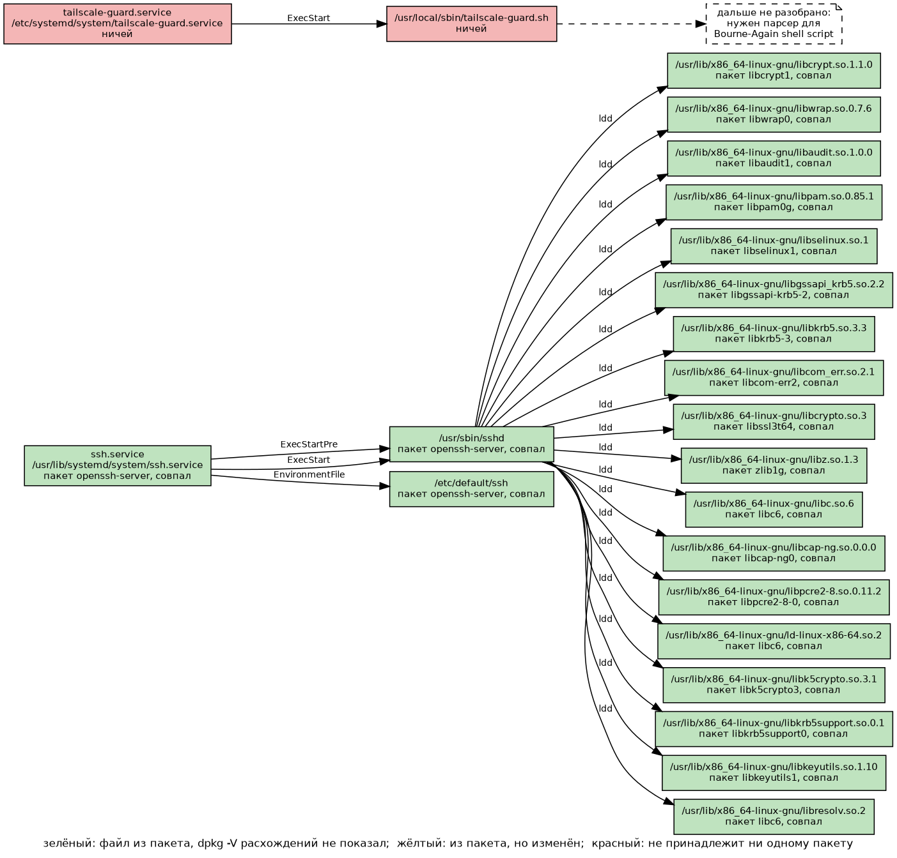
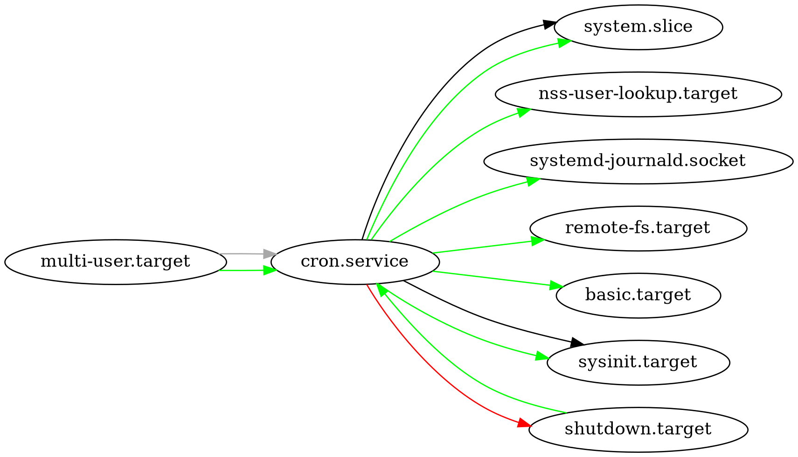

# systemd-file-graph

Домашний проект: bash-скрипт, который рисует граф файлов для сервиса systemd.

Даёшь ему имя юнита, он показывает, какой бинарник запускается, какие библиотеки тот подгружает и из каких файлов берутся переменные. Для каждого файла подписано, из какого он пакета.



Написан на чистом bash, около 60 строк. Сам скрипт ничего не разбирает: он склеивает вывод штатных команд и отдаёт результат в graphviz. Ничего нового тут нет, хотелось проверить, сколько можно собрать одним шеллом.

## Запуск

Нужны Debian или Ubuntu (из-за `dpkg`), systemd и graphviz.

```
./graph_min.sh ssh.service cron.service | dot -Tpng -o graph.png
```

Аргументы: имена юнитов, можно несколько. На выходе текст в формате DOT, пример лежит в `files_min.dot`.

## Как это работает

| Команда | Что из неё берётся |
|---|---|
| `systemctl show` | путь к файлу юнита, программы из `ExecStartPre`, `ExecStart`, `ExecStartPost`, файлы из `EnvironmentFile` |
| `file` | тип файла: бинарник или скрипт |
| `ldd` | библиотеки, которые подгрузит бинарник |
| `dpkg -S`, `dpkg -V` | какому пакету принадлежит файл и совпал ли он с пакетом |
| `dot` | картинка |

Что пришлось учесть в самом bash:

- узлы не дублируются: уже напечатанные пути лежат в ассоциативном массиве, поэтому общая библиотека двух сервисов рисуется один раз;
- `dpkg -V` вызывается один раз на пакет, его вывод кешируется;
- пути приводятся через `realpath`, иначе симлинки дают лишние узлы;
- на системах с объединённым `/usr` dpkg может знать файл как `/sbin/x`, а на диске он `/usr/sbin/x`, поэтому пакет ищется по обоим вариантам.

## Цвета

- зелёный: файл из пакета, `dpkg -V` расхождений не показал;
- жёлтый: файл из пакета, но изменён;
- красный: dpkg про файл не знает.

На картинке два юнита с моего сервера. У `ssh.service` 21 файл, все совпали с пакетами. У `tailscale-guard.service` (самописный сервис) и юнит, и скрипт красные. Красный не значит «плохой»: так выглядит всё, что положено на сервер руками.

## Чем отличается от systemd-analyze dot

У systemd есть своя команда для графа. Она рисует связи между юнитами: кто после кого и кто кого требует. Файлов на таком графе нет.



## Ограничения

- Shell-скрипты не разбираются: граф останавливается на скрипте и ставит узел «дальше не разобрано».
- `ldd` выдаёт плоский список, без указания, какая библиотека потянула какую. Он запускает загрузчик, поэтому на незнакомых бинарниках его лучше не использовать.
- Сверка идёт с локальной базой dpkg, а не с репозиторием.
- Только юниты systemd и только Debian-подобные системы.

## Файлы

- `graph_min.sh`: сам скрипт;
- `files_min.dot`, `files_min.png`, `files_min.svg`: его вывод для `ssh.service` и `tailscale-guard.service`;
- `units_*.png`, `units_*.svg`: вывод `systemd-analyze dot` для сравнения.
